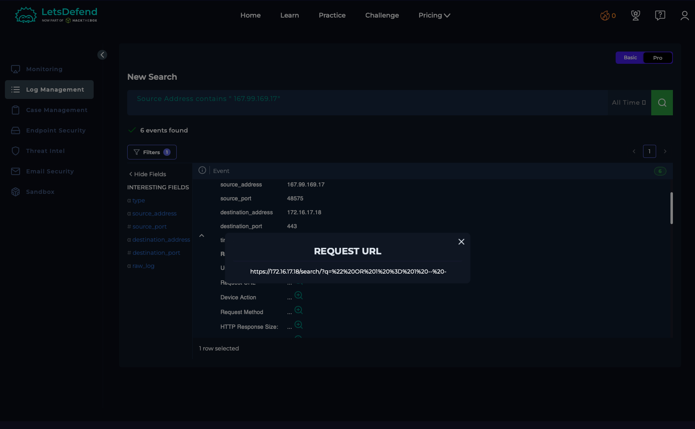
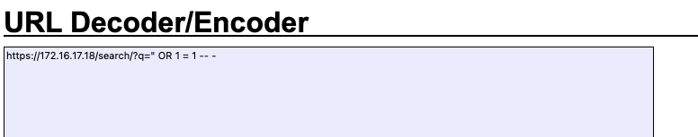

# Case 01 — SQL Injection Attempt (Blocked)

**Verdict:** True Positive — Attack Blocked
**Date:** Feb 25, 2022
**Source:** LetsDefend SOC training environment

## Alert
Web application firewall / IDS alert on inbound traffic to `WebServer1001` (172.16.17.18) from external IP `167.99.169.17`.

**Request logged:**
```
GET /search/?q=%22%20OR%201%20%3D%201%20--%20-
```
Decoded: `q=" OR 1 = 1 -- -`

HTTP response: `500`, response size 948 bytes.

## Investigation
I started by pulling the raw request URL for the source IP to see exactly what was sent, since the alert summary alone doesn't tell you whether a SQLi attempt actually landed. Decoding the query string gave me `q=" OR 1 = 1 -- -` — a textbook boolean-bypass payload, the kind used to trick a backend query into returning `true` regardless of the real search term.

From there the question was whether it worked. I checked the response code and size: a 500 with a small body (948 bytes) reads as the query breaking at the application layer rather than actually executing against the database — if the injection had succeeded, I'd expect either a 200 with unexpected data back, or a much larger response body reflecting a dumped result set. Neither was present.

I also scanned the surrounding log window for repeat requests from the same source IP — no follow-up probing, no escalation to a different parameter or technique. That told me this looked like an automated scanner throwing a single payload rather than a targeted, hands-on-keyboard attempt.

## Indicators
| Type | Value |
|---|---|
| Attacker IP | 167.99.169.17 |
| Target host | WebServer1001 (172.16.17.18) |
| Payload | `" OR 1 = 1 -- -` |

## MITRE ATT&CK Mapping
- **T1190 — Exploit Public-Facing Application**

## Impact
No data exposure or database compromise. Attack failed at the application layer.

## Remediation
- No host containment needed — attack did not reach execution.
- Recommended the payload and source IP be shared with the application/dev team to confirm parameterized queries (not string concatenation) are enforced on the search endpoint, since a 500 error alone doesn't guarantee the underlying query logic is safe long-term.
- Recommend adding the source IP to a watchlist in case of repeat probing.

## Screenshots

*Log search filtered on the attacker's source IP, showing the raw request URL*


*URL-decoded payload confirming the `OR 1=1` boolean-bypass string*