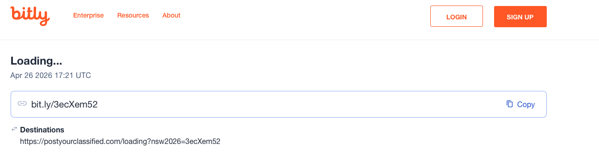
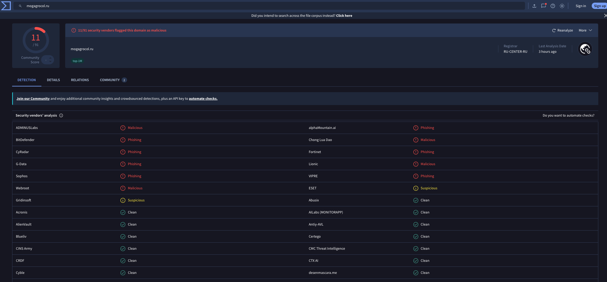
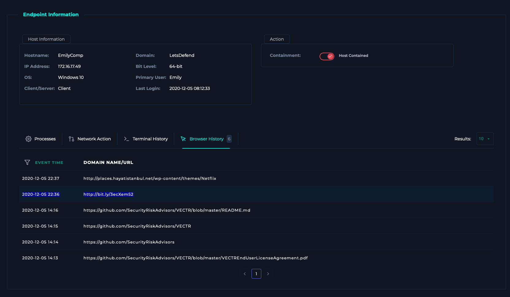

# Case 03 — Phishing Link → Credential Harvesting Redirect

**Verdict:** True Positive — Contained
**Date:** Dec 05, 2020
**Source:** LetsDefend SOC training environment

## Alert
User `ellie` on host `EmilyComp` (172.16.17.49) visited a link that resolved to an external site, device action logged as **Allowed**.

## Investigation
The email was made to look like it came from `admin@netflix-payments.com` and the actual link was hidden behind a `bit.ly` shortener — that alone is worth pausing on, since there's no legitimate reason for a payments notification to route through a public link shortener rather than the vendor's own domain.

I resolved the redirect manually to see where it actually went: `bit.ly/3ecXem52` → `postyourclassified.com/loading?...` → `mogagrocol.ru`. I ran the final domain through VirusTotal and it came back flagged malicious by multiple vendors.

What made me confident this wasn't just a generic spam link was the URL parameter on the landing page — `?email=ellie@letsdefend.io` had been appended to it. That's the tell of a pre-filled credential harvesting page: the attacker is passing the victim's own email address into the fake login form so it looks personalized and legitimate instead of a blank, generic prompt.

I pulled Ellie's browser history to confirm what actually happened on her end rather than assuming from the proxy log alone, and it showed the `bit.ly` link was clicked at 22:36 — so the "Allowed" device action wasn't just permitted traffic sitting in a log, the user genuinely reached the page. I also checked where the destination IP (91.189.114.8) geolocates — Russia — which lined up with the domain's VirusTotal reputation and made me treat this as a real credential-harvesting attempt rather than a false alarm.

## Indicators
| Type | Value |
|---|---|
| Impacted user/host | ellie / EmilyComp (172.16.17.49) |
| Malicious domain | mogagrocol.ru |
| Destination IP | 91.189.114.8 |
| Redirect chain | bit.ly/3ecXem52 → postyourclassified.com → mogagrocol.ru |

## MITRE ATT&CK Mapping
- **T1566.002** — Phishing: Spearphishing Link
- **T1204.001** — User Execution: Malicious Link
- **T1598** — Phishing for Information (credential harvesting intent)

## Impact
Potential credential compromise for user `ellie`. No confirmed follow-on account misuse observed at time of investigation, but risk of lateral access if credentials were entered.

## Remediation
- Isolated `EmilyComp` via EDR as a precaution while credential exposure was assessed.
- Forced an immediate password reset and revoked active sessions for `ellie`.
- Submitted `mogagrocol.ru` and `91.189.114.8` as malicious indicators for blocklisting.
- Recommended user security awareness follow-up given the personalization technique used in the lure.

## Screenshots

*Bitly link resolving to the `postyourclassified.com` intermediate redirect*

*VirusTotal results flagging `mogagrocol.ru` as malicious*

*Endpoint browser history confirming Ellie clicked the bit.ly link at 22:36*