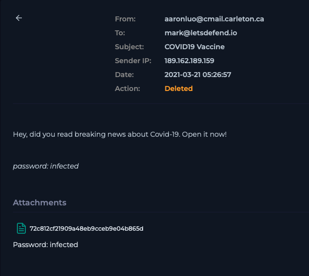

# Case 04 — Phishing Email → Password-Protected Malicious Attachment (Deleted)

**Verdict:** True Positive — Deleted, No Endpoint Impact
**Date:** Mar 21, 2021
**Source:** LetsDefend SOC training environment

## Alert
Inbound email from `aaronluo@cmail.carleton.ca` (SMTP 189.162.189.159), subject "COVID19 Vaccine," addressed to `mark@letsdefend.io`. Device action: **Deleted**.

## Investigation
The lure was current-events bait rather than anything targeted: *"Hey, did you read breaking news about Covid-19. Open it now!"* — generic, urgency-driven phrasing designed to get a fast click rather than anything crafted specifically for Mark. Sender domain (`cmail.carleton.ca`) had no relationship to the organization, which was the first thing that told me this wasn't legitimate correspondence.

The attachment itself was a password-protected zip, with the password ("infected") sitting right in the email body — the same technique I ran into on [Case 06](../case-06-phishing-dormant-payload/). It's a deliberate move: a password-protected archive can't be scanned by most gateway and antivirus engines, since they can't open it to inspect the contents. Handing the recipient the password in plain text is what lets the intended victim (and only the intended victim) unlock it.

I didn't extract or open the file — I pulled the MD5 hash directly off the attachment (`72c812cf21909a48eb9cceb9e04b865d`) and checked it against VirusTotal, which confirmed it as malicious. From there I checked the mail gateway logs to see what actually happened to the message: device action showed **Deleted**, meaning the email was removed before it became a standing risk in Mark's mailbox. I still reviewed his endpoint telemetry as a secondary check regardless of the gateway's action, looking for any extraction or execution activity tied to the file — found nothing, consistent with the email never having been acted on.

## Indicators
| Type | Value |
|---|---|
| Sender | aaronluo@cmail.carleton.ca |
| SMTP IP | 189.162.189.159 |
| Attachment | Password-protected zip (password: `infected`) |
| File hash (MD5) | 72c812cf21909a48eb9cceb9e04b865d |

## MITRE ATT&CK Mapping
- **T1566.001** — Phishing: Spearphishing Attachment
- **T1027.002** — Obfuscated Files or Information: Software Packing *(password-protected archive used to evade static AV/gateway scanning)*

## Impact
None. The malicious email was deleted before it could be acted on, and endpoint telemetry confirmed no extraction or execution occurred on Mark's workstation.

## Remediation
- Confirmed the email was removed from the mailbox/queue; no further gateway action needed.
- No host containment required — verified clean via endpoint telemetry.
- Logged the file hash and sender infrastructure as indicators for future detection.
- Noted for awareness: password-protected archives are a known blind spot for scanning engines — worth flagging to email security tooling owners as a detection gap, since the technique relies on the scanner's inability to inspect contents rather than any flaw in the payload itself.

## Screenshots

*Phishing email as received — sender, subject, and password-protected zip attachment*
