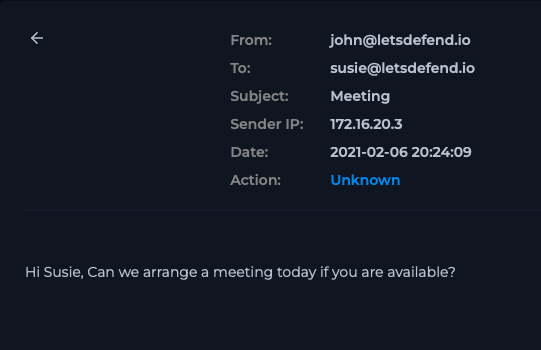

# Case 05 — Internal Email Flagged as Suspicious (False Positive)

**Verdict:** False Positive
**Date:** Feb 06, 2021
**Source:** LetsDefend SOC training environment

## Alert
Email from `john@letsdefend.io` to `susie@letsdefend.io`, subject "Meeting", sent via internal SMTP relay (172.16.20.3), flagged for review.

## Investigation
First thing I checked was whether either address was spoofed or lookalike — both `john@` and `susie@` are internal corporate addresses on the org's own mail infrastructure, not external domains dressed up to look internal. That already made a phishing angle unlikely.

I read the message itself for anything that would justify the alert — attachments, embedded links, tracking pixels, unusual formatting. There was none of that; it was a one-line internal message asking to schedule a meeting. Nothing about the content matched the profile of the alert type.

At that point I stopped looking for a threat and started looking for why the alert fired at all. The common thread was the sending IP, `172.16.20.3` — an internal SMTP relay. That pointed to a detection rule that's watching for suspicious mail-relay behavior but isn't scoped to exclude the organization's own trusted relay, so it's flagging legitimate internal traffic as if it came from an untrusted source.

## Assessment
No malicious indicators. This was a detection logic issue, not a genuine threat.

## Remediation
- No containment action needed.
- Flagged the rule to the SIEM engineering/detection team to add the internal SMTP relay IP (172.16.20.3) to a trusted allowlist, to reduce future noise and analyst fatigue from repeat false positives on this same traffic pattern.

## Why this case matters
Correctly identifying and closing false positives — and feeding the reason back into rule tuning — is as much a part of the SOC analyst job as catching real threats. Alert fatigue from unscoped rules is a common, costly problem in SOCs, and this is the kind of finding that should get escalated for tuning rather than just closed and forgotten.

## Screenshots

*Internal email details showing sender, recipient, and internal SMTP relay IP*