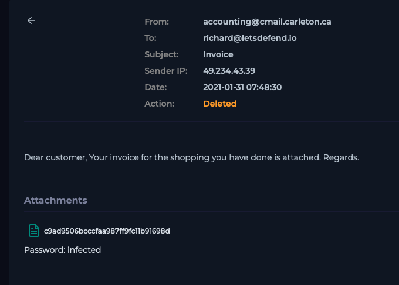

# Case 06 — Phishing Attachment Delivered, No User Interaction

**Verdict:** True Positive — No Impact (No Execution)
**Date:** Jan 31, 2021
**Source:** LetsDefend SOC training environment

## Alert
Email from `accounting@cmail.carleton.ca` (SMTP 49.234.43.39), subject "Invoice," delivered to `richard@letsdefend.io`, device action: **Allowed**.

## Investigation
The sender domain (`cmail.carleton.ca`) has nothing to do with the organization, and the SMTP IP didn't match any of our trusted mail infrastructure — that alone put this in "probably not real accounting correspondence" territory before I even looked at the attachment. The body was generic enough to fit any recipient: *"Dear customer, Your invoice for the shopping you have done is attached."* No name, no order number, no reason to think this was actually meant for Richard specifically — a sign of a mass phishing send rather than a targeted one.

The attachment was a password-protected zip, with the password ("infected") given right in the email body. That's a deliberate move, not an inconvenience — a password-protected archive can't be scanned by most mail gateway and antivirus engines, since they can't open it to inspect what's inside. Putting the password in plain text is what actually lets the intended victim unlock it. I didn't enter the password or extract the file myself; per safe-handling practice I don't detonate suspected live malware, even in an isolated analysis environment, unless that's specifically what the exercise calls for. Instead I pulled the MD5 hash directly off the attachment (`c9ad9506bcccfaa987ff9fc11b91698d`) and checked it against VirusTotal, which came back confirmed malicious.

With the file itself off-limits, the real question became whether Richard had opened it. I went through his endpoint telemetry looking for three things: file-extraction activity, any process execution tied to the attachment, and outbound network traffic to unfamiliar domains in the window after delivery. All three came back clean — the email had been sitting in his mailbox, password and all, without him touching it.

## Indicators
| Type | Value |
|---|---|
| Impacted user | richard@letsdefend.io |
| Sender | accounting@cmail.carleton.ca |
| SMTP IP | 49.234.43.39 |
| File hash (MD5) | c9ad9506bcccfaa987ff9fc11b91698d |

## MITRE ATT&CK Mapping
- **T1566.001** — Phishing: Spearphishing Attachment

## Impact
None realized — the payload was delivered but never executed. Risk was fully contained by the user not interacting with the attachment before the SOC responded.

## Remediation
- Manually purged the email from Richard's mailbox to eliminate any future accidental-open risk.
- No host containment required — telemetry confirmed zero execution.
- Logged the file hash and SMTP IP as indicators for blocklisting.
- Noted for awareness: this case shows why gateway "Allowed" delivery alone isn't sufficient — analysis needs to independently confirm user interaction status rather than assuming delivery equals compromise.

## Screenshots

*Phishing email as delivered — sender, subject, and password-protected zip attachment*