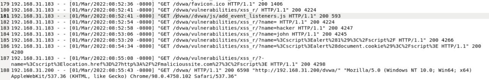
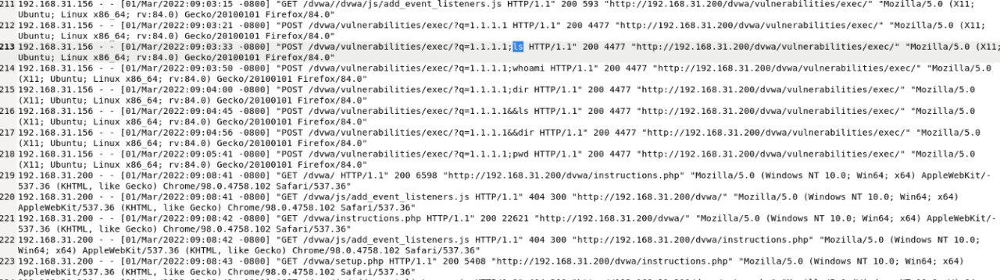
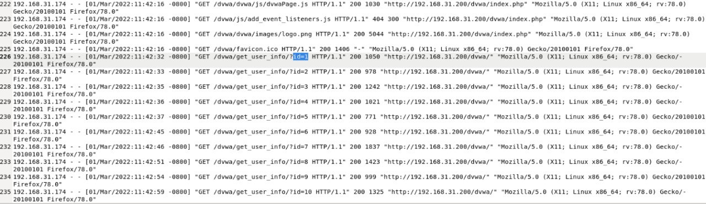
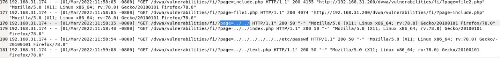

# Case 07 — Multi-Vector Web Application Attack Investigation (Apache Access Log)

**Verdict:** Mixed — 2 attempts confirmed/successful, 2 attempted but unsuccessful
**Source:** LetsDefend log-analysis lab (DVWA target environment)
**Method:** Manual Apache access log review — no platform dashboard, raw log analysis only

## Overview

This investigation covers four separate attack attempts identified while reviewing an Apache access log against a DVWA (Damn Vulnerable Web Application) target: reflected XSS, OS command injection, an IDOR, and local file inclusion / path traversal. Rather than one alert, this mirrors a realistic SOC shift — working through several distinct findings from the same log source, not just one clean scenario.

| # | Finding | Attacker IP | Verdict |
|---|---------|-------------|---------|
| 1 | Reflected XSS | 192.168.31.183 | True Positive — attempt confirmed, execution unverifiable server-side |
| 2 | OS Command Injection | 192.168.31.156 | True Positive — attempted, not successful |
| 3 | IDOR | 192.168.31.174 | True Positive — successful |
| 4 | LFI / Path Traversal | 192.168.31.174 | True Positive — attempted, not successful |

---

## Finding 1: Reflected XSS

**Attacker IP:** 192.168.31.183
**Start time:** 01/Mar/2022:08:53:20

I noticed a clear escalation pattern in the requests to `/dvwa/vulnerabilities/xss_r/` rather than a single payload:

```
GET /dvwa/vulnerabilities/xss_r/?name=%3Cscript%3Ealert(1)%3C%2Fscript%2F HTTP/1.1" 200 4266
GET /dvwa/vulnerabilities/xss_r/?name=%3Cscript%3Ealert(document.cookie)%3C%2Fscript%3E HTTP/1.1" 200 4280
GET /dvwa/vulnerabilities/xss_r/?-name=%3Cscript%3Elocation.href%3D%27http%3A%2F%2Fmaliciousite.com%3C%2Fscript%3E HTTP/1.1" 200 4298
```



**Why this matters:** the attacker didn't stop at a proof-of-concept `alert(1)` — they moved to `alert(document.cookie)` (testing whether they could read session cookie data) and then a `location.href` redirect to an external domain (`maliciousite.com`), which is consistent with a session-hijacking or credential-phishing attempt.

**On success determination:** I initially read the consistent HTTP 200 responses as confirmation the attack succeeded, but a server-side access log alone can't actually confirm whether injected JavaScript executed in a victim's browser — that's a client-side event the server log has no visibility into. The response sizes here (4266–4298) are also close enough to normal baseline traffic that they don't independently confirm anything either. What the log **does** support is the clear intent and escalation from test payload to a credential-theft-oriented payload.

**ATT&CK mapping:** T1190 (Exploit Public-Facing Application), T1539 (Steal Web Session Cookie) — reflects the attacker's apparent goal, not confirmed execution.

**Verdict:** True Positive (attack attempt confirmed) — execution/success not independently verifiable from server-side logs alone.

---

## Finding 2: OS Command Injection — Not Successful

**Attacker IP:** 192.168.31.156
**Start time:** 01/Mar/2022:09:03:33

```
POST /dvwa/vulnerabilities/exec/?q=1.1.1.1;whoami HTTP/1.1" 200 4477
POST /dvwa/vulnerabilities/exec/?q=1.1.1.1;dir HTTP/1.1" 200 4477
POST /dvwa/vulnerabilities/exec/?q=1.1.1.1;ls HTTP/1.1" 200 4477
POST /dvwa/vulnerabilities/exec/?q=1.1.1.1&&dir HTTP/1.1" 200 4477
POST /dvwa/vulnerabilities/exec/?q=1.1.1.1;pwd HTTP/1.1" 200 4477
```



Every single injection attempt returned the **exact same response size (4477 bytes)**, regardless of which command was appended. If any of these commands had actually executed, I'd expect the response size to vary — `whoami` returns a short username, `dir`/`ls` returns a full directory listing, `pwd` returns a path — all different lengths. An identical size across every attempt tells me none of the injected commands actually ran; the application likely just returned its normal ping-result page each time.

**Also worth noting:** the attacker mixed Linux commands (`whoami`, `ls`, `pwd`) with a Windows command (`dir`) — suggesting they didn't know the target OS and were testing both, another sign this was exploratory/manual probing rather than a targeted, informed attack.

**ATT&CK mapping:** T1190 (Exploit Public-Facing Application), T1059 (Command and Scripting Interpreter) — attempted, not achieved.

**Verdict:** True Positive — Attempted, Not Successful.

---

## Finding 3: IDOR (Insecure Direct Object Reference)

**Attacker IP:** 192.168.31.174
**Start time:** 01/Mar/2022:11:42:32

```
GET /dvwa/get_user_info/?id=1 HTTP/1.1" 200 1050
GET /dvwa/get_user_info/?id=2 HTTP/1.1" 200 978
GET /dvwa/get_user_info/?id=3 HTTP/1.1" 200 1242
...sequentially through id=10
```



The attacker manually incremented the `id` parameter from 1 through 10, pulling back different user records each time with no authorization check evident in the response pattern — a textbook IDOR, walking an object reference to enumerate other users' data.

**On the "not automated" conclusion:** the timing between requests is irregular — gaps of 1s, 2s, 1s, 1s, 8s, 1s, 5s, 3s, 5s rather than a consistent interval. A scripted/automated enumeration tool would typically hit the endpoint at a fixed, regular interval; this pattern looks like manual, human-paced browsing/testing instead.

**ATT&CK mapping:** T1190 (Exploit Public-Facing Application).

**Verdict:** True Positive — Successful, manually conducted (not automated).

---

## Finding 4: Local File Inclusion / Path Traversal — Not Successful

**Attacker IP:** 192.168.31.174 (same source as Finding 3, ~16 minutes later)
**Start time:** 01/Mar/2022:11:58:35

```
GET /dvwa/vulnerabilities/fi/?page=../../ HTTP/1.1" 200 50
GET /dvwa/vulnerabilities/fi/?page=../../index.php HTTP/1.1" 200 50
GET /dvwa/vulnerabilities/fi/?page=../../../../../etc/passwd HTTP/1.1" 200 50
GET /dvwa/vulnerabilities/fi/?page=../../text.php HTTP/1.1" 200 50
```



Compared to legitimate file requests earlier in the same log (`file1.php` returning 4074 bytes, `file2.php` returning 4155 bytes), every traversal attempt here returned an identical, tiny 50-byte response — including the `/etc/passwd` attempt. A real successful read of `/etc/passwd` would return a distinctly sized, non-identical block of file content. The fact that every attempt returned the same small size strongly suggests the application returned a generic error page each time rather than actual file contents.

**ATT&CK mapping:** T1190 (Exploit Public-Facing Application), T1005 (Data from Local System) — attempted, not achieved.

**Verdict:** True Positive — Attempted, Not Successful.

## Cross-Case Observation

The same source IP (192.168.31.174) appears in both Finding 3 (IDOR) and Finding 4 (LFI), roughly 16 minutes apart. Combined with the manual-pacing evidence from Finding 3, this points to a single human attacker working through multiple attack vectors against the same target in one session, rather than separate automated scans.

## Remediation Recommendations

- **XSS:** Enforce output encoding/escaping on all reflected parameters; implement a Content Security Policy (CSP) to limit inline script execution.
- **Command Injection:** Eliminate direct OS command execution from user input entirely; if unavoidable, strictly allow-list permitted input and use parameterized execution, not string concatenation.
- **IDOR:** Implement server-side authorization checks on every object reference — verify the requesting user actually owns or has rights to the requested `id`, not just that they're authenticated.
- **LFI/Path Traversal:** Validate and sanitize file path input against an allow-list of permitted files; never construct file paths directly from user-supplied input.
