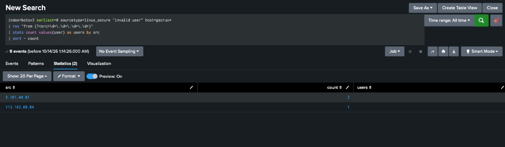

# Case 09 — SSH Password Spray on a Web Server

**Verdict:** True Positive — Password guessing
**Date:** 20 Aug 2018
**Source:** Splunk Boss of the SOC v3 dataset (`index=botsv3`)

## Alert
Failed SSH authentications for account names that do not exist, on a host named `gacrux`, which is a web server in this dataset.

## Investigation
Windows Security failed logons were the wrong place to look. `EventCode=4625` returned three events, and `Source_Network_Address` was empty. The accounts were `Guest`, `MalloryKraeusen`, and `SEPM$`. `SEPM$` is the Symantec Endpoint Protection service account, so those events are noise, not the spray.

The guesses were in `/var/log/secure` (`sourcetype=linux_secure`) as `invalid user`. Each attempt is logged twice, once as a pre-auth request and once with the source address. Grouping the lines that include `from <ip>`:

| Source | Failed guesses | Usernames |
|---|---|---|
| 5.101.40.81 | 3 | default, cron, camera |
| 113.162.80.84 | 1 | admin |

Host: `gacrux.i-0920036c8ca91e501`. A threshold of 20, or even 5, would have hidden this. The whole set is eight log lines.

```spl
index=botsv3 earliest=0 sourcetype=linux_secure "invalid user" host=gacrux*
| rex "from (?<src>\d+\.\d+\.\d+\.\d+)"
| stats count values(user) as users by src
| sort - count
```

The time range has to be All time. These events are from 2018.

## Indicators
| Type | Value |
|---|---|
| Host | gacrux.i-0920036c8ca91e501 |
| Log | /var/log/secure |
| Source | 5.101.40.81 |
| Source | 113.162.80.84 |
| Usernames attempted | default, cron, camera, admin |

## MITRE ATT&CK Mapping
- **T1110** — Brute Force
- **T1110.003** — Password Spraying (several usernames, one guess each, rather than many guesses against one account)

## Impact
No successful logon was in this result set. The risk is a later success against one of those names, or the same sources trying real accounts.

## Remediation
- Alert on `invalid user` from one external source across more than one username in a short window. Do not require 20 failures. This spray would never reach that count.
- Keep `SEPM$` and other service accounts out of the Windows failed-logon alert when the source address is empty. Those events are not this attack.
- Block or watch `5.101.40.81` and `113.162.80.84` at the SSH perimeter for the web servers.

## Screenshot

*Three guesses from 5.101.40.81 and one from 113.162.80.84*
