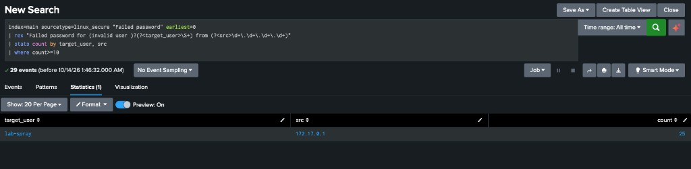

# Case 10 — SSH Failed-Password Threshold

**Verdict:** True Positive — Alert, with noise excluded
**Source:** Linux SSH authentication log, indexed in Splunk (`index=main`, `sourcetype=linux_secure`)

## Alert
Repeated failed SSH passwords for one account from a single source.

## Investigation
The auth log contained 29 `Failed password` lines from `172.17.0.1`.

| Account | Source | Failed passwords |
|---|---|---|
| lab-spray | 172.17.0.1 | 25 |
| lab-noise | 172.17.0.1 | 4 |

A count of every failure would alert on both accounts. I set the threshold at 10 failures for one account from one source. `lab-spray` stayed. `lab-noise` dropped out.

```spl
index=main sourcetype=linux_secure "Failed password" earliest=0
| rex "Failed password for (invalid user )?(?<target_user>\S+) from (?<src>\d+\.\d+\.\d+\.\d+)"
| stats count by target_user, src
| where count>=10
```

Time range: All time.

## Indicators
| Type | Value |
|---|---|
| Source | 172.17.0.1 |
| Account over threshold | lab-spray (25) |
| Account under threshold | lab-noise (4) |

## MITRE ATT&CK Mapping
- **T1110** — Brute Force
- **T1110.001** — Password Guessing

## Impact
No successful logon in this result set. The risk is a later success against `lab-spray` if the guesses continue.

## Remediation
- Alert when one account has 10 or more failed SSH passwords from one source.
- Leave accounts under that count out of the alert. `lab-noise` is the example: 4 failures is not the same pattern.
- Block or watch `172.17.0.1` if the `lab-spray` failures continue.

## Screenshot

*`lab-spray` from 172.17.0.1, 25 failed passwords. The 4 failures for `lab-noise` are not in the result.*
