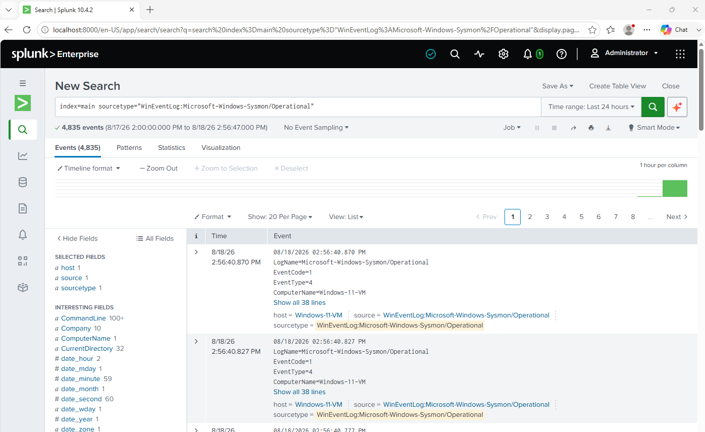

# Detection Engineering Lab — Sysmon + Splunk + Atomic Red Team

A self-built detection lab where I simulated real attack techniques and built the Splunk queries to catch them, using my own endpoint telemetry rather than a pre-built dataset.

**Scope, by design:** everything runs on a single Windows 11 VM acting as victim, SIEM, and attacker at once. Given a one-day build window, I chose depth on a small number of techniques over breadth across a multi-host network — no separate attacker VM, no simulated network segmentation. The tradeoff is intentional and noted here rather than glossed over.

## Environment
- **Victim/SIEM host:** Windows 11 (VirtualBox)
- **Endpoint telemetry:** Sysmon, SwiftOnSecurity config (`sysmon64.exe -accepteula -i`, then applied `sysmonconfig-export.xml`)
- **SIEM:** Splunk Enterprise (trial license; will move to Splunk Free — no auth required, 500MB/day cap — after the trial period, which is sufficient for this use case)
- **Log ingestion:** Sysmon operational log manually added to `inputs.conf`, since the Splunk GUI's input picker didn't list the Sysmon channel:
  ```
  [WinEventLog://Microsoft-Windows-Sysmon/Operational]
  disabled = 0
  index = main
  renderXml = false
  ```
- **Attack simulation:** Atomic Red Team (`Invoke-AtomicRedTeam` PowerShell module)
- **Note:** Windows Defender was disabled on this isolated VM so the atomic tests could execute without being deleted mid-run. This is a deliberate, isolated-lab-only choice made to observe technique behavior — not a production practice.

## Results

| # | Technique | ATT&CK ID | Result |
|---|-----------|-----------|--------|
| 1 | [Regsvr32 Proxy Execution](./technique-01-regsvr32-t1218-010/) | T1218.010 | Detected |
| 2 | [Obfuscated PowerShell Execution](./technique-02-powershell-t1059-001/) | T1059.001 | Detected |
| 3 | [LSASS Credential Dumping (ProcDump)](./technique-03-lsass-t1003-001/) | T1003.001 | Blocked by OS control (LSA Protection / PPL) |

Each writeup covers what I ran, what I observed in the process chain, the Splunk detection query I built (or, for technique 3, what blocked the attack and what detection would look like if it hadn't), and remediation recommendations.

## Setup Verification

