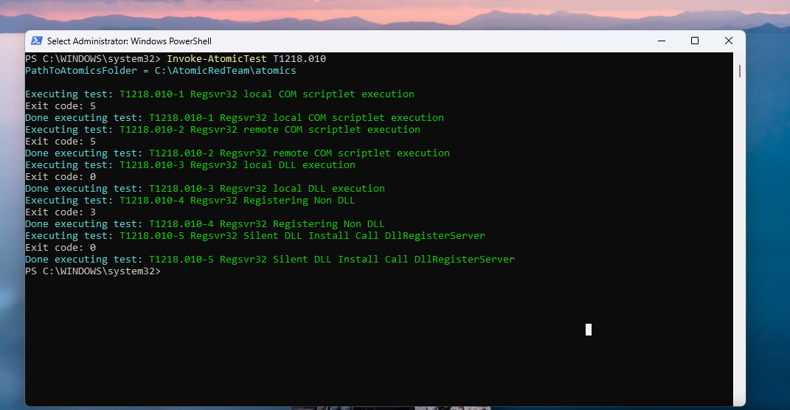
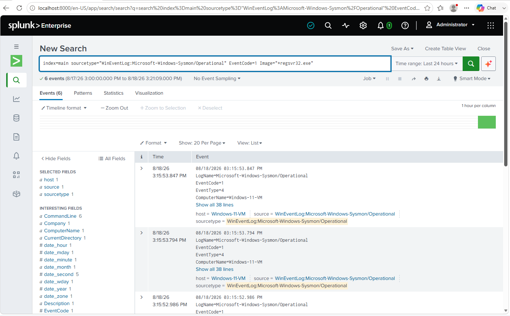
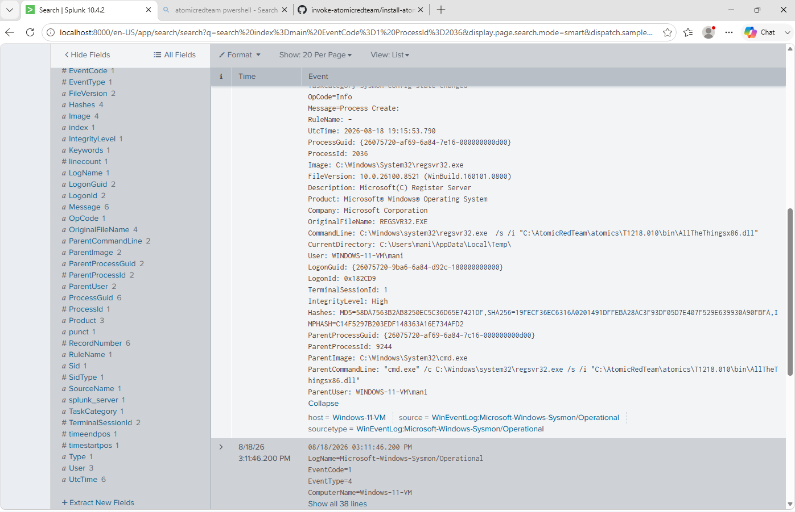
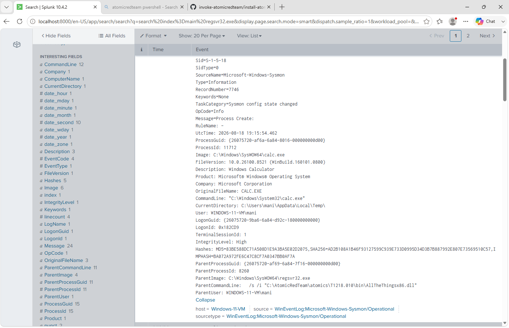

# Technique 01 — Regsvr32 Proxy Execution

**ATT&CK ID:** T1218.010 — System Binary Proxy Execution: Regsvr32
**Result:** Detected
**Tool:** Atomic Red Team (`Invoke-AtomicTest T1218.010`)
**Environment:** Windows 11 VM, Sysmon (SwiftOnSecurity config) → Splunk

## What I Ran
I started with `Invoke-AtomicTest T1218.010 -ShowDetails` to see what the test actually does before firing it, then ran `Invoke-AtomicTest T1218.010` without a test number, which executed all four sub-tests in sequence.

## What I Observed
Calculator popped open on its own partway through the run. That's the tell built into this atomic test — `calc.exe` launching is the proof that the DLL registered by `regsvr32` actually executed its payload rather than failing silently.

**Process chain (from Sysmon Event ID 1 in Splunk):**
```
cmd.exe → regsvr32.exe (64-bit, /s /i "AllTheThingsx86.dll") → regsvr32.exe (32-bit, WOW64 relaunch) → calc.exe
```

The 64-bit `regsvr32.exe` relaunched itself as the 32-bit version under WOW64 to load a 32-bit DLL — that hop is expected and specific to loading a DLL that doesn't match the host process architecture, not something unusual on its own.

The two flags that matter:
- `/s` — silent mode, suppresses the success/failure dialog a normal registration would show
- `/i` — calls the DLL's `DllInstall` export instead of the standard `DllRegisterServer` export, and can take an optional command-line argument. This is the flag attackers rely on, since it lets a signed, trusted Windows binary hand off execution to arbitrary code inside the DLL — the kind of proxy execution that's built specifically to slip past controls that only block unsigned or unrecognized executables.

## Detection

I built two queries against the Sysmon data:

```
index=main EventCode=1 Image="*regsvr32.exe" CommandLine="*/i*" CommandLine="*/s*"
```
Catches the specific `/s /i` flag combination used in this technique.

```
index=main EventCode=1 ParentImage="*regsvr32.exe"
```
Broader and more robust — under normal, legitimate use `regsvr32.exe` doesn't spawn child processes. Any child process under `regsvr32.exe` is worth a look regardless of what flags were passed, which makes this the query I'd trust more in a real environment since it doesn't depend on the attacker using a specific flag pattern I already know about.

## Why This Matters
Regsvr32 is a signed Microsoft binary that's allowed to run almost everywhere, which is exactly why it gets abused — code execution disguised as a normal DLL registration walks past application whitelisting and defenses that trust signed binaries by default. Flag-based detection catches the known pattern; parent/child relationship-based detection catches the technique even if the attacker changes flags.

## Remediation
- If seen in production: isolate the host, pull the DLL hash and submit it for reputation/blocklisting, and trace the parent process chain further up (what spawned `cmd.exe`) to see whether this was part of a larger delivery chain rather than an isolated event.
- Longer term: alert on any child process of `regsvr32.exe`, since that relationship alone is anomalous outside of this kind of abuse.

## Screenshots

*Atomic test execution*


*Splunk search results*


*Parent process (cmd.exe) in the event chain*


*calc.exe proof-of-execution*
