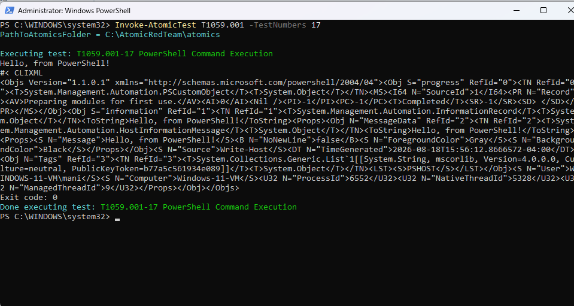
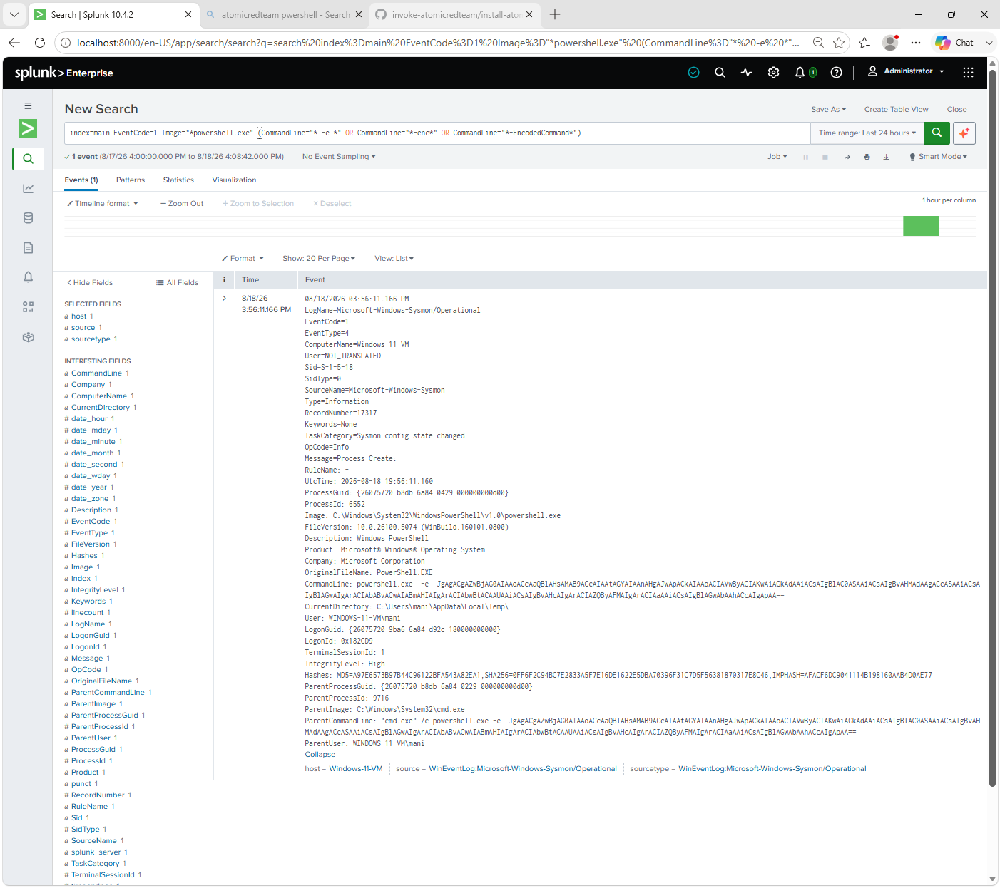
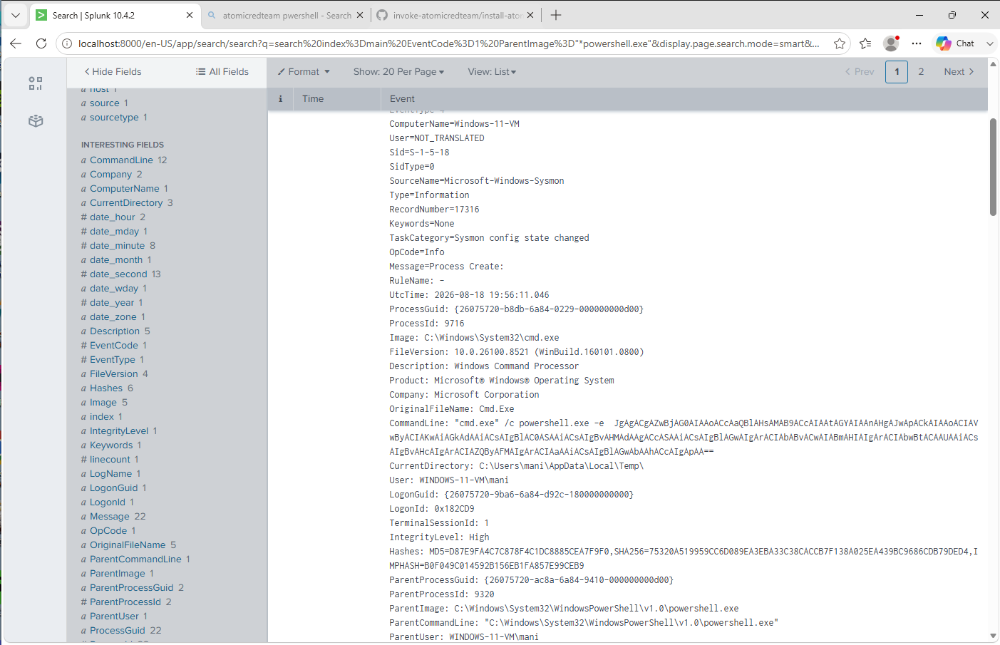
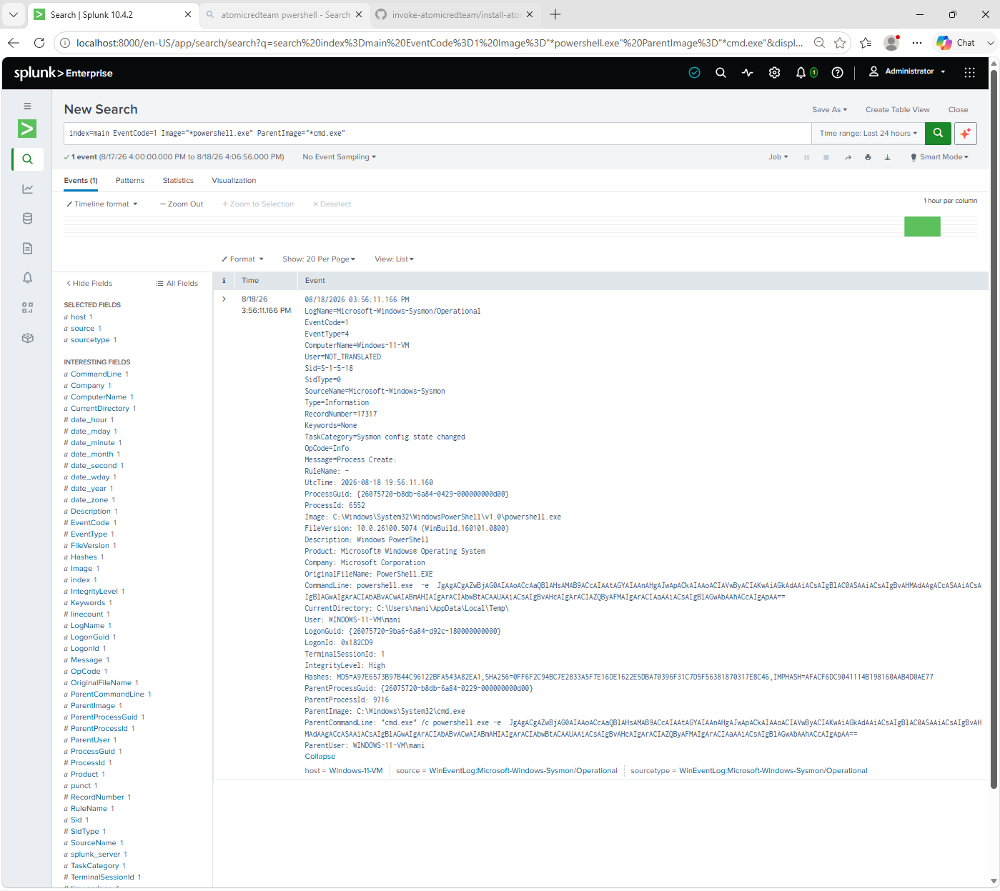
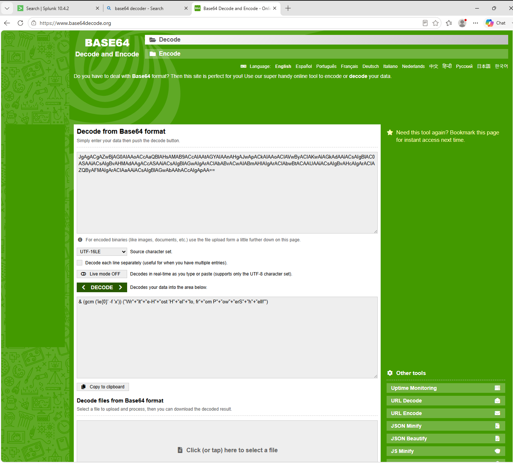

# Technique 02 — Obfuscated PowerShell Execution

**ATT&CK ID:** T1059.001 — Command and Scripting Interpreter: PowerShell
**Result:** Detected
**Tool:** Atomic Red Team (`Invoke-AtomicTest T1059.001 -TestNumbers 17`)
**Environment:** Windows 11 VM, Sysmon (SwiftOnSecurity config) → Splunk

## What I Ran
I picked test #17 specifically because it's modeled on a real intrusion documented in Red Canary's 2021 Threat Detection Report, rather than a generic PowerShell one-liner. I ran `Invoke-AtomicTest T1059.001 -TestNumbers 17`.

## What I Observed
The script printed `Hello, from PowerShell!`, some CLIXML output, and exited with code 0 — a clean, successful run. Splunk returned three Sysmon Event ID 1 events for the same timestamp.

**Process chain:**
```
powershell.exe (interactive session) → cmd.exe → powershell.exe -e [Base64-encoded command]
```

What makes this test interesting is the obfuscation approach. Instead of calling `Invoke-Expression` (`iex`) directly — which is a string that plenty of naive detections just grep for — the encoded command reconstructs it at runtime with `Get-Command 'ie{0}' -f 'x'`, building the string `iex` on the fly via format-string substitution. The literal string `iex` never appears anywhere in the command line. It's a reminder that string-matching on the decoded content isn't enough on its own; the value of `-enc`/`-e` detection is that it doesn't care what's inside the payload, only that a command was encoded and handed to PowerShell.

## Detection

```
index=main EventCode=1 Image="*powershell.exe" (CommandLine="* -e *" OR CommandLine="*-enc*" OR CommandLine="*-EncodedCommand*")
```

This returned all three events. Because it keys off the encoding flag rather than any specific string inside the payload, it catches this technique regardless of how the attacker chose to obfuscate the actual command — including tricks like the format-string reconstruction used here that would dodge a detection built around known-bad keywords like `iex`.

## Why This Matters
`-EncodedCommand` is legitimate and common in automation, which is exactly why an outright block is the wrong call — it would break real tooling. But the base rate of legitimate encoded PowerShell in most environments is low enough that alerting on it (and decoding the payload for review) is a reasonable, low-noise detection.

## Remediation
- Enable PowerShell Script Block Logging so the decoded command content is captured regardless of how it was encoded — that's what actually lets an analyst see what ran, rather than just that something was encoded.
- Alert on `-enc`/`-e`/`-EncodedCommand` usage for review rather than blocking outright, to avoid disrupting legitimate automation that relies on encoded commands.

## Screenshots

*Atomic test execution and output*


*Three matching events in Splunk*


*Encoded command in the event details*


*Process chain showing cmd.exe as parent*


*Decoded Base64 payload*
