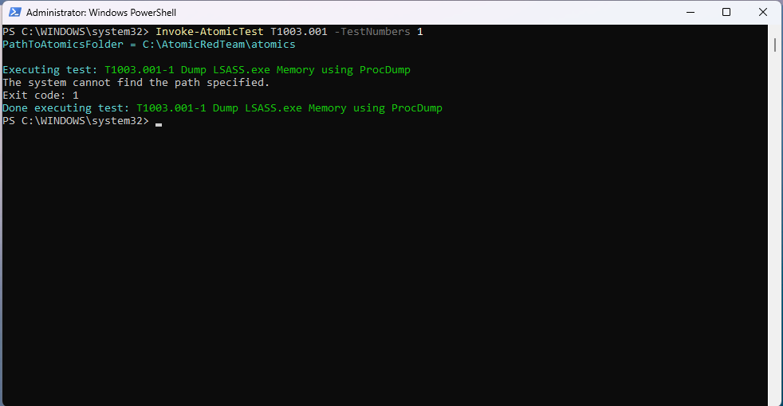
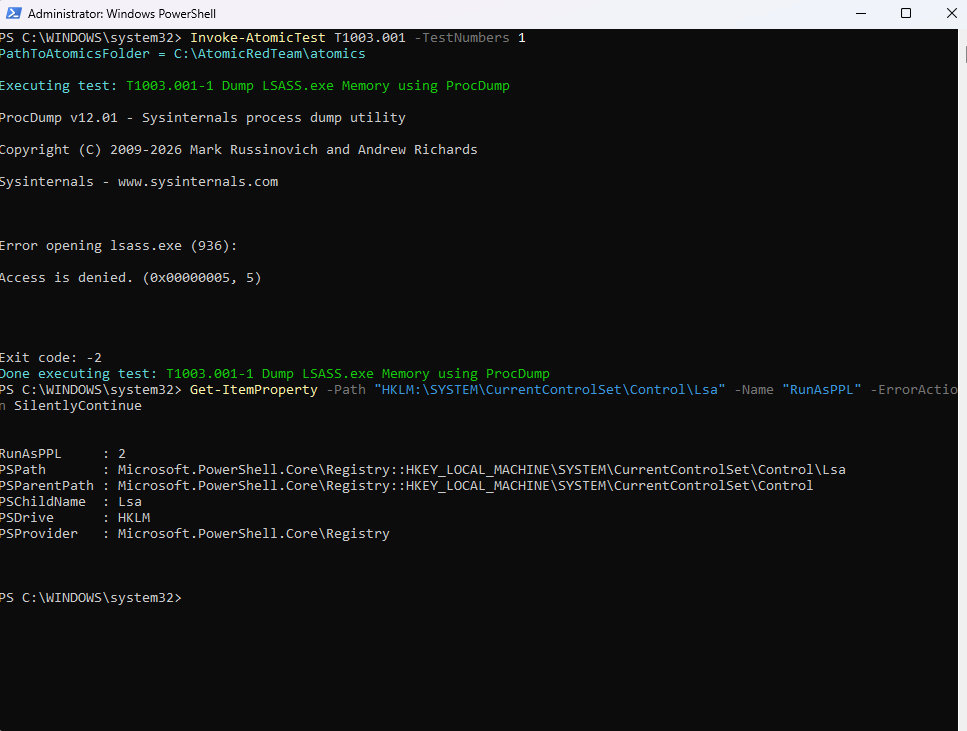

# Technique 03 — LSASS Credential Dumping via ProcDump

**ATT&CK ID:** T1003.001 — OS Credential Dumping: LSASS Memory
**Result:** Blocked by OS-level control (LSA Protection / PPL)
**Tool:** Atomic Red Team (`Invoke-AtomicTest T1003.001 -TestNumbers 1`)
**Environment:** Windows 11 VM, Sysmon (SwiftOnSecurity config) → Splunk

## What I Ran
I ran `-ShowDetails` first to confirm what the test does, then executed `Invoke-AtomicTest T1003.001 -TestNumbers 1`, which uses Sysinternals ProcDump to attempt a full memory dump of `lsass.exe` (`procdump -mm lsass.exe`) — the classic first move in credential dumping, since LSASS memory holds cached credentials and password hashes.

## What Happened
The dump failed immediately:
```
Error opening lsass.exe: Access is denied
```

I wanted to know whether that was just a permissions issue or something stronger, so I checked the registry:
```
HKLM:\SYSTEM\CurrentControlSet\Control\Lsa → RunAsPPL = 2
```

`RunAsPPL = 2` means LSA Protection is enabled *with a UEFI lock*, not the standard registry-level protection. The distinction matters: a value of `1` can be disabled by an attacker with admin rights simply by flipping the registry key and rebooting. A UEFI-locked value of `2` can't be undone that way — the setting is enforced at the firmware level, so even an attacker with full local admin and a reboot can't turn it back off through the registry alone.

## Why I'm Treating This as a Finding, Not a Dead End
This test didn't produce a detection to build, because Windows blocked the attack before it reached the point where Sysmon would have logged anything meaningful. But that's the finding: it demonstrates that this host has a real, firmware-enforced OS control in place for one of the most common credential-theft techniques, which is worth as much as a clean detection — arguably more, since prevention beats detection when both are available.

**Caveat, for balance:** PPL/LSA Protection isn't an absolute guarantee. Attackers have bypassed it in the wild using BYOVD (Bring Your Own Vulnerable Driver) techniques — loading a signed but vulnerable driver to get code running at a privilege level that can still access LSASS memory despite the protection. So this control raises the bar significantly but isn't a substitute for detection coverage.

## What Detection Would Look Like If This Weren't Blocked
If LSA Protection were disabled or bypassed, the expected signal is:

```
Sysmon Event ID 10 (ProcessAccess), TargetImage="*lsass.exe"
```

Any process requesting access to `lsass.exe` — particularly with the access rights ProcDump requests for a full memory dump — from a process that isn't a normal system component is a strong indicator of credential dumping and should be a high-priority alert.

## Remediation
- Confirm LSA Protection (`RunAsPPL = 2`, UEFI-locked) is enforced fleet-wide via Group Policy or MDM, not just present on this host.
- Don't rely on PPL alone — build the Sysmon Event ID 10 / `TargetImage=*lsass.exe` detection anyway, since BYOVD techniques exist specifically to defeat this control.
- Restrict and monitor driver-loading behavior (Sysmon Event ID 6) as a complementary control against BYOVD-style bypasses of LSA Protection.

## Screenshots

*Initial test invocation*


*ProcDump "Access is denied" output and the `RunAsPPL = 2` registry query result*
